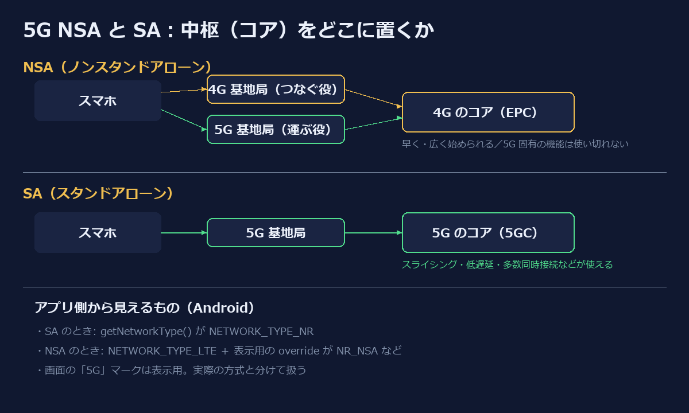

総務省が 2026年10月30日に公表した「デジタルインフラ整備計画2030に基づく5Gインフラの整備状況（令和7年度末）」に、携帯各社の 5G SA（スタンドアローン）の状況がまとまっていました。ニュースでは「本当の5G」という言い方をよく見かけます。ただ、エンジニアとして読むなら、SA と NSA は「速いか遅いか」ではなく **中枢をどこに置くかという設計判断の違い** として見るほうがすっきりします。

この記事では、その見方で SA / NSA を整理します。そのうえで、アプリを書く側から実際に何が見えるのか（Android の API で何が返るのか）と、表示と実体を取り違えたときに起きる誤解についても書きます。

## 電波とコアは別の層

携帯の通信は、基地局の電波（無線アクセス）だけでは完結しません。その奥にコアネットワークがあり、認証、セッションの管理、どこへ転送するかといった判断はそこで行われます。

ここが設計の要点です。「5G になった」と言うとき、変わったのが電波だけなのか、コアまで変わったのかで意味がまったく違います。

## NSA は「既存のコアを使い回す」判断

5G の最初の段階では、多くの事業者が NSA を選びました。5G の電波を使いつつ、コアは 4G のもの（EPC）を使い続ける構成です。端末はまず 4G の基地局とつながり、そこに 5G の電波を足してデータを運びます（EN-DC：E-UTRA と NR のデュアルコネクティビティ）。

この判断には合理性があります。

- 既存のコアと 4G のエリアをそのまま土台にできるので、**早く・広く**5G を始められる
- コアの作り直しという大きな工事を後回しにできる

代わりに、コアが 4G のままなので、5G のコアを前提にした機能は使い切れません。いわば「技術的負債を承知で、先にリリースする」選択です。

## SA は「コアまで作り直す」判断

SA はコアも 5G 用（5GC）にした構成です。総務省の資料で各社が挙げている SA の使い道は、たとえば次のようなものです。

- **ネットワークスライシング**：1つの物理的なネットワークを用途ごとに論理的に分け、混雑していても決めた通信を優先する
- **低遅延**：ゲームのストリーミングや遠隔操作など、反応の速さが効く用途
- **VoNR**：5G のまま音声通話をする
- **RedCap** など IoT 向けの使い方の拡大

どれも「電波が速い」というより、**コアが通信の扱い方を細かく制御できる**ことで生まれる機能です。だからこそ SA は、電波ではなくコアの話として読むのが正確です。

逆に言えば、SA にしたからといって、ふだんの下りの速度が急に上がるわけではありません。資料の中でも、ある事業者は「NSA を使っているときよりも品質が下がらないように」SA を提供していると説明しています。移行の最初の目標は、まず「劣化させないこと」なのです。

## 日本の状況（2026年10月の総務省資料より）

- ドコモ・KDDI・ソフトバンクは、すでに SA のエリアを広げています。主要駅、スタジアム、山手線沿線などから順に広げ、スライシングを使った法人向けサービスや実証も進んでいます。
- 楽天モバイルについては、コアネットワークで SA 化に向けた開発を進めており、**2026年12月末ごろを目途に運用を開始する予定**、その後**端末の検証などを経て商用化する見込み**とされています。

「12月末ごろ」は運用開始の目途であり、利用者向けのサービス開始日ではない点に注意が必要です。コアを作り直したあと、端末ごとの検証という長い工程が続くのは、どの事業者でも同じです。

## アプリ側から何が見えるか（Android）

Android の公式リファレンスには、この違いがはっきり書かれています。

- `TelephonyManager.NETWORK_TYPE_NR`（API 29、値 20）の説明は「Current network is NR (New Radio) 5G. **This will only be returned for 5G SA. For 5G NSA, the network type will be NETWORK_TYPE_LTE.**」です。
- NSA のときは、`TelephonyDisplayInfo.getOverrideNetworkType()` が `OVERRIDE_NETWORK_TYPE_NR_NSA`（値 3）などを返します。これは「LTE につながっていて EN-DC が使える、または NR に副次的につながっている」状態を表します。

ここに落とし穴があります。`getOverrideNetworkType()` について、リファレンスは「market branding or visualization purposes only」で、**実際にキャンプしているネットワークの種類として扱ってはいけない**と明記しています。`TelephonyDisplayInfo` 自体も「表示目的」の情報で、事業者のポリシーに沿って決まるとされています。

つまり、画面に「5G」と出ていても、それだけでは SA かどうかはわかりません。

- **実体**（SA かどうか）は `getNetworkType()` / `getDataNetworkType()` が `NETWORK_TYPE_NR` かで見る
- **表示**（ユーザーに 5G と見せるか）は override で決まる

ログや分析の基盤で「5G 利用率」を数えるとき、この2つを混ぜると、NSA の端末を SA と数えてしまいます。指標の名前と中身がずれる、典型的な事故のパターンです。具体的なコードは Qiita に別にまとめる予定です。

## 設計判断として読み直す

| | NSA | SA |
|---|---|---|
| コア | 4G（EPC）を使い回す | 5G（5GC）に作り直す |
| 狙い | 早く・広く始める | 5G ならではの制御を使う |
| 代償 | 5G 固有の機能を使い切れない | コアの開発と端末の検証に時間がかかる |
| 端末から見た実体 | `NETWORK_TYPE_LTE` ＋ override | `NETWORK_TYPE_NR` |

「先に出して、あとで土台を作り直す」というのは、ソフトウェアの世界でもよくある判断です。5G の SA 移行は、その作り直しを、全国規模のインフラと膨大な端末の組み合わせで行っている状態だと見ると、時間がかかる理由も、各社の進み方に差が出る理由も、腹落ちしやすくなります。

## 出典

- 総務省「デジタルインフラ整備計画2030に基づく5Gインフラの整備状況（令和7年度末）の公表」（2026年10月30日）https://www.soumu.go.jp/menu_news/s-news/01kiban14_02000810.html （資料 PDF「SA活用レポートの概要」）
- Android Developers「TelephonyManager」https://developer.android.com/reference/android/telephony/TelephonyManager
- Android Developers「TelephonyDisplayInfo」https://developer.android.com/reference/android/telephony/TelephonyDisplayInfo

※筆者は楽天グループの従業員です。この記事は公開資料をもとにした個人の整理で、会社の見解ではありません。
