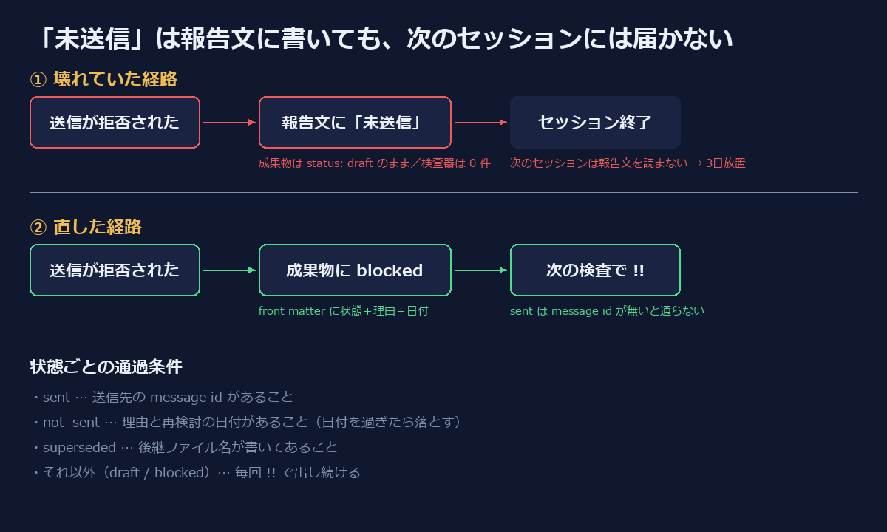

個人の自動化プロジェクトで、AIエージェント（Claude Code）に「毎週の教材を作って、チャットで相手に案内を送る」作業を任せている。教材はMarkdownのファイルで、作ったら検査スクリプトを通し、クラウドの共有フォルダに置き、最後にチャットへ案内を投稿する。

ある週、この最後の投稿だけが通らなかった。エージェントはそれを正しく見つけて「案内は未送信です」と報告した。それでも案内は**3日間だれにも送られなかった**。相手から「今週分がまだ来ていない」と言われて、ようやく気づいた。

この記事は、その3日間がなぜ起きたかと、直した仕組みのメモ。



## 症状: 全部終わっていて、投稿だけが欠けていた

その週のセッションでやったことを並べると、ほぼ全部が成功していた。

- 教材ファイル6本を作成し、検査スクリプト（lint）は問題0件
- 共有フォルダへの配置と同期も確認済み
- チャットへの案内投稿だけが、ツールの実行許可で拒否された

エージェントはセッションの最後に、ユーザー向けの報告文で「投稿は拒否されたので未送信」と書いた。嘘は1つもない。

ところが、次のセッションはこの報告文を読まない。成果物のファイルは `status: draft` のまま残っていて、「書きかけ」にしか見えない。検査スクリプトは「送られたかどうか」を見ていなかったので、問題0件と答えた。結果として、**未送信という事実を持っていたのは、閉じたセッションの会話ログだけ**になった。

## 原因: 状態を書いた場所が、次に読まれる場所ではなかった

エージェントの作業は、セッションをまたいで引き継がれるものと引き継がれないものに分かれる。

| 置き場所 | 次のセッションで読まれるか |
|---|---|
| 成果物のファイル（front matter を含む） | 読まれる。検査スクリプトの対象にもなる |
| リポジトリのコミット履歴 | 読まれることがある |
| セッション中のユーザー向け報告文 | **読まれない** |

人間が報告文を読んで、その場で手を動かせば問題は起きない。ただ、報告が「エージェントが自分で見つけて自分で書いたもの」だと、人間の側も「把握されているなら次に拾われるだろう」と読み流しやすい。拾う側の仕組みは、実際にはどこにも無かった。

もう1つ、思い込みがあった。**ファイルを共有フォルダに置いたことを「届いた」と数えていた。** 相手が見ているのはチャットの投稿で、共有フォルダは投稿から参照される先にすぎない。置いた6本は、3日間だれにも開かれていなかった。

さらに悪いことに、届いていない期間の「相手の反応がない」は、そのまま読むと「この週の教材は響かなかった」という間違った測定結果になる。

## 対処: 送信の状態を成果物そのものに書き、検査で落とす

直した方針は単純で、**送信の結果は成果物の front matter に書く。報告文には書いても書かなくてもよい**、にした。

```yaml
---
status: sent
sent_msg_id: "1762312345678"
---
```

到達の証拠は、チャット側が返す **message id ただ1つ**にした。「投稿したはず」「ファイルは置いた」は証拠にしない。id が無ければ届いていない扱いにする。

そのうえで、検査スクリプトに「送るべき成果物は、終わった状態になっているか」の項目を足した。実際のコードを少し簡略化して載せる。

```python
# 送るべき成果物があるフォルダの一覧。
# 新しい週のフォルダはここに足すこと。足さないと、何も検査せずに 0 件と報告する。
PATTERNS = ["20261101/Curriculum*.md", "20261105/Curriculum*.md", ...]

for pat in PATTERNS:
    for f in sorted(glob.glob(str(BASE / pat))):
        t = Path(f).read_text(encoding="utf-8")
        st = re.search(r"^status: (\w+)", t, re.M)
        mid = re.search(r'^sent_msg_id: "(\d+)"', t, re.M)
        state = st.group(1) if st else None

        if state == "superseded":
            # 送らずに新しい版へ置き換えた。後継のファイル名が書いてなければ落とす
            ok = not mid and re.search(r"Curriculum_\w+_\d{8}\.md", t.split("変更履歴")[-1])
        elif state == "not_sent":
            # 意図して送らなかった。理由が書いてなければ落とす
            ok = not mid and re.search(r"^not_sent_reason: \S", t, re.M)
        else:
            # それ以外は sent かつ message id があるときだけ通す
            ok = state == "sent" and mid

        print(f"  {'ok' if ok else '!!'} {Path(f).name:40s} {state or '-'} {mid.group(1) if mid else '-'}")
        if not ok:
            problems += 1

sys.exit(1 if problems else 0)
```

ポイントは3つある。

1. **`draft` と `blocked` は「終わった状態」として許さない。** 送信が拒否されたらその場で `status: blocked` と `blocked_at` を書く。検査は毎回 `!!` を出し続けるので、次のセッションの最初に検査を走らせれば必ず目に入る
2. **送らないことを選ぶ状態（`not_sent` と `superseded`）は許すが、理由か後継の名前を必須にする。** そうしないと、この状態が「送るべきものを置いておく場所」になる
3. **検査対象の一覧に、その週のフォルダが入っているか**を確かめる。フォルダを週ごとに作る構成なので、一覧に足し忘れた週のファイルは何も検査されないまま問題0件として素通りする

エージェントへの作業指示にも「セッションの最初に検査を走らせ、`!!` の送信を最初に片付ける」を足した。

## 追記: 意図して送らなかった場合にも期限が要る

この仕組みを入れたあと、別の形でもう一度遅れた。

ある週、残りの教材を作ったが、こちらの判断で送らなかった。根拠は「直前の案内に『残りは来週に回します』と書いてあり、相手の側にはもう指示が立っている」。その時点では正しかった。

ところが「来週」には期限がある。来週が終わった時点で、この根拠は自動的に失効した。失効を見ている仕組みは無く、8日間未送信のまま過ぎた。`not_sent_reason` は書いてあったので、上の検査は `ok` を出し続けていた。

ここから足したルールは次のとおり。

- **見送りの根拠が「相手の側に指示が立っている」なら、その指示の期限が見送りの期限。** 理由と一緒に、再検討する日付を書く
- 再検討の条件は「動きがあったら」ではなく**日付で書く。** 動きが無いこと自体が条件なので、「◯月◯日までに返事が無ければ送る」と書く
- 検査は、その日付を過ぎた `not_sent` を `!!` に戻す（いまは運用ルールとして書いた段階で、上のコードへの組み込みはこれから）

```yaml
---
status: not_sent
not_sent_reason: "前回の案内で『残りは来週』と伝え済み。相手側に指示が有効"
revisit_by: 2026-11-14   # この日を過ぎたら検査で !! に戻す
---
```

相手から見ると、送れなかった原因が「拒否」でも「見送り」でも結果は同じで、約束された案内が届かないだけ。そして相手が何も言わないことを「問題なし」と読むと、気づくのは必ず遅れる。

## 教訓

- **エージェントの報告文は、次のセッションに引き継がれない。** 未完了の状態は、次に必ず読まれる場所（成果物のファイル）に書く
- **「届いた」の証拠は送信先が返す id 1つに絞る。** ファイルを置いた、検査が通った、は到達ではない
- **終わった状態を限定し、それ以外は検査で毎回落とす。** 送らないことを選ぶ状態は、理由・後継・期限のどれかを必須にする
- **検査が0件と言ったら、対象が空でないかも見る。** 対象外のファイルは、何も検査されないまま問題0件になる

---

📩 LINE で深掘り配信中

AI / マーケ / 楽天モバの限定情報を 週1〜2回 お届け（無料）

興味のあるテーマだけ選んで受け取れます

[友だち追加する 👉](https://mame-follow.suikou0.workers.dev/follow?cha=zenn)

AIエージェント運用 / MMM / 楽天モバ紹介 の3テーマから選べます
