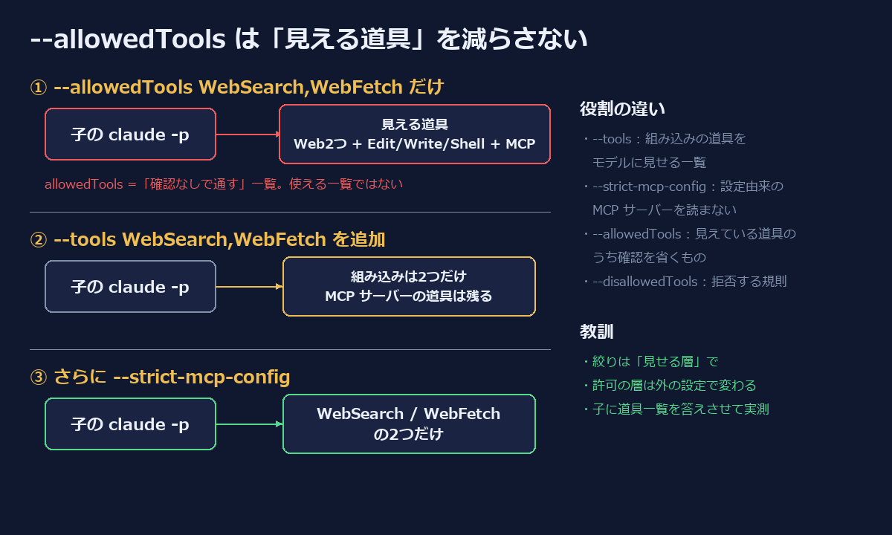

個人の自動化プロジェクトで、Python の定時ジョブから Claude Code を headless(`claude -p`)で呼んでいる。ニュースを Web で調べて要約させる、記事の下書きを書かせる、といった用途で、呼び出し箇所は10本ほどある。

どれも「この子には Web 検索と取得だけさせる」つもりで、こう書いていた。

```python
cmd = [exe, "--print", "--output-format", "text",
       "--allowedTools", "WebSearch,WebFetch"]
```

ところが、ある日この子に「今使える道具を全部列挙して」と聞いてみると、`WebSearch` と `WebFetch` のほかに **Edit・Write・シェル(PowerShell)・設定済みの MCP サーバーの道具** まで並んで返ってきた。



## 症状: 許可リストに無い道具がモデルから見えている

定時ジョブの子エージェントは、外から取ってきた Web ページの本文を読む。つまりプロンプトインジェクションの入口がある。そこに書き込みやコマンド実行の道具が見えているのは、意図していた状態ではなかった。

実害は出ていなかったが、出なかった理由は「モデルが使おうとしなかった」だけで、構成として防いでいたわけではない。

## 原因: --allowedTools は「確認なしで通す」一覧

`claude --help` を読み直すと、道具に関わるフラグは役割が分かれている。

```text
--allowedTools <tools...>     Comma or space-separated list of tool names to allow (e.g. "Bash(git *) Edit")
--disallowedTools <tools...>  Comma or space-separated list of tool names to deny
--tools <tools...>            Specify the list of available tools from the built-in set.
                              Use "" to disable all tools, "default" to use the default set,
                              or specify tool names (e.g. "Bash,Edit,Read").
--strict-mcp-config           Only use MCP servers from --mcp-config, ignoring all other MCP configurations
```

`--allowedTools` は **権限の規則**(この道具は確認を求めずに実行してよい)であって、**モデルに見せる道具の一覧** ではない。一覧を決めるのは `--tools` のほうだった。

整理するとこうなる。

| フラグ | 層 | 効果 |
|---|---|---|
| `--tools` | 見せる層 | 組み込み道具のうち、モデルに渡すもの |
| `--strict-mcp-config` | 見せる層 | ユーザー/プロジェクト設定の MCP サーバーを読まない |
| `--allowedTools` | 許可の層 | 見えている道具のうち、確認なしで通すもの |
| `--disallowedTools` | 許可の層 | 拒否する規則 |

`--allowedTools` しか付けていないと、組み込みの道具は既定の一式がそのまま見え、`~/.claude` などに登録した MCP サーバーの道具も全部読み込まれる。リストに無い道具を実際に呼んだときに通るかどうかは、許可の層(権限モードや settings.json の allow 規則)次第になる。

この「許可の層」は、スクリプトの外にある設定ファイルで変わる。対話セッションの便利のために settings.json に allow を足したり、権限モードを緩めたりすると、定時ジョブの子にもそのまま効いてしまう。スクリプト側の1行を信じていると、そこに気づけない。

## 対処: --tools と --strict-mcp-config で「見せる層」から絞る

Web だけ使う子はこう直した。

```python
cmd = [exe, "--print", "--output-format", "text",
       "--tools", "WebSearch,WebFetch",   # 組み込みはこの2つだけ見せる
       "--strict-mcp-config",             # 設定由来の MCP サーバーを読まない
       "--allowedTools", "WebSearch,WebFetch"]  # 見えている2つは確認なしで通す
```

`--allowedTools` は残している。headless では確認に答える人がいないので、見せた道具を確認なしで通すにはこちらも要る。

用途によって組み合わせが変わる。

```python
# 特定の MCP サーバーの道具だけ使う子:
# 組み込みは全部消し、MCP は設定から読ませる(--strict-mcp-config は付けない)
cmd = [exe, "--print", "--tools", "",
       "--allowedTools", "mcp__myserver__get_items,mcp__myserver__get_item_detail"]
```

`--strict-mcp-config` を付けると MCP サーバーが1つも読まれなくなるので、MCP を使う子には付けない(必要なら `--mcp-config` で使うサーバーだけを渡す)。

### 直ったことを確かめる

フラグの意味を読んで直しただけでは、また思い込みになる。子に道具の一覧を答えさせて、段階ごとに確かめた。

```powershell
"今使える道具の名前を1行に1つずつ列挙して。説明は不要。" |
  claude -p --tools "WebSearch,WebFetch" --strict-mcp-config --allowedTools "WebSearch,WebFetch"
```

1. `--allowedTools` だけ → Edit・Write・シェル・MCP の道具まで並ぶ
2. `--tools` を追加 → 組み込みは2つになるが、MCP の道具は残る
3. `--strict-mcp-config` を追加 → `WebSearch` と `WebFetch` の2つだけ

そのうえで、直した定時ジョブのうち2本を実際に回し、Web 検索で結果が取れることを確認した。

### 横展開

同じ書き方は1か所だけではなかった。`--allowedTools` を grep して、子 Claude を呼んでいる箇所を全部洗った。

```bash
grep -rn -- "--allowedTools" --include=*.py .
```

10本のうち、Web 系は `--tools <Web の道具> --strict-mcp-config`、MCP だけを使うものは `--tools ""` にそろえた。`--disallowedTools Edit,Write,Bash` を足して「拒否しているから大丈夫」としていた箇所もあったが、拒否リストは列挙漏れがあると穴になる(シェルの道具名が環境で違う、MCP 側に書き込みの道具がある、など)。許可した物だけ見せる形のほうが漏れにくい。

## 教訓

- **`--allowedTools` は許可の規則で、道具の一覧ではない。** 子エージェントの道具を絞るなら `--tools`(組み込み)と `--strict-mcp-config` / `--mcp-config`(MCP)の「見せる層」で絞る
- **許可の層はスクリプトの外の設定で変わる。** 対話用に緩めた設定が、無人で動く子にも効く。無人の子ほど、見せる層で閉じておく
- **拒否リストより「見せる物だけ」。** 拒否する名前を並べる方式は、知らない道具が増えたときに漏れる
- **子に自分の道具を答えさせて実測する。** フラグの名前から意味を推測しない。直した後も、一覧を出させて確かめる

外部の Web ページを読む子に書き込みの道具が見えている状態は、プロンプトインジェクションが1回通れば手元のファイルが書き換わる構成だった。「使わなかったから大丈夫」ではなく、「見えていないから使えない」にしておくのが、無人で回すエージェントの最低ラインだと思う。

---

📩 LINE で深掘り配信中

AI / マーケ / 楽天モバの限定情報を 週1〜2回 お届け（無料）

興味のあるテーマだけ選んで受け取れます

[友だち追加する 👉](https://mame-follow.suikou0.workers.dev/follow?cha=zenn)

AIエージェント運用 / MMM / 楽天モバ紹介 の3テーマから選べます

