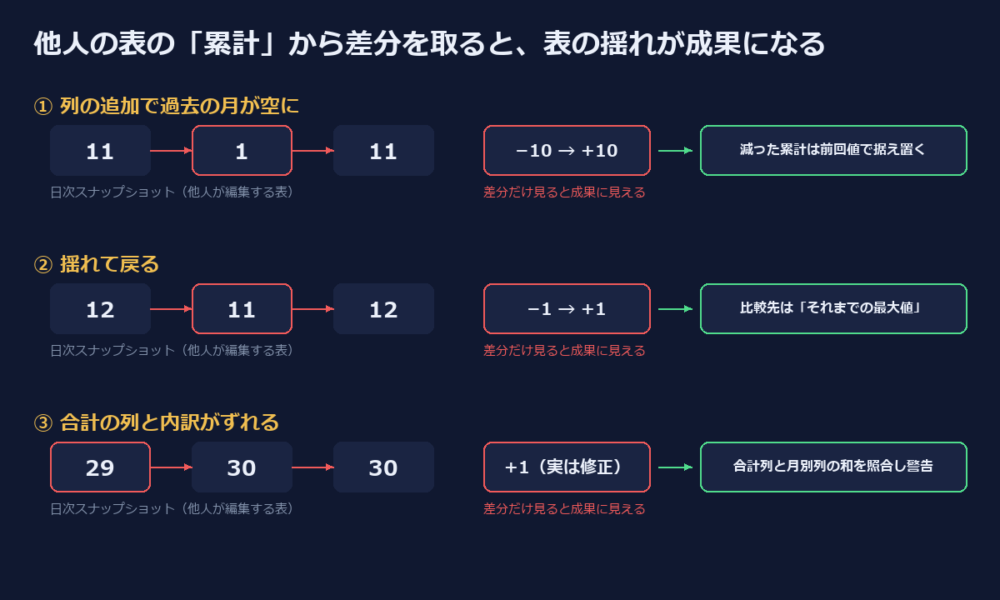

個人の自動化プロジェクトで、成果の数字（登録・申込・完了の3つの累計）を**自分では作っていない表**から毎日取り込んでいる。表は別の人が Excel で管理していて、毎日1ファイルずつ共有フォルダに置かれる。こちらはそれをダウンロードし、累計を1日1行の CSV に貯め、週次レポートで「今週 +N」と出す。

この「今週 +N」が、1週間のうちに3回、**何も起きていないのに増えて見えた**。どれも原因は表の編集の揺れで、こちらの計算は「累計は減らない・合計は正しい」という前提に乗っていた。

この記事はその3つの型と、それぞれに入れた直し方のメモ。



## 前提: 取り込みと週次の計算

取り込みは単純で、その日の表から累計を読み、日付をキーに貯めるだけだった。

```python
def ingest_one(date, xlsx, store):
    data = parse(xlsx)   # {"login_cum": 31, "application_cum": 12, "opening_cum": 12, ...}
    store[date] = {"report_date": date, **data}
```

週次レポートは「週の最新の行」と「週が始まる前の最後の行」の差を取っていた。

```python
for k in ("login", "application", "opening"):
    c = cum(latest, f"{k}_cum")
    out[k] = {"delta": c - (cum(base, f"{k}_cum") if base else c), "cum": c}
```

累計なのだから、差を取れば増分になる。ここまでは自然に見える。

## 型① 列を足したら過去の月が空になった（11 → 1）

### 症状

ある日の取り込みで、「完了」の累計が **11 → 1** と記録された。他の2つ（登録・申込）は正常。

### 原因

表は「月ごとの列」と「累計の列」を持っていて、月が変わるたびに新しい月の列が右に足される。その日は新しい月の列を足したときに、**今年の1〜10月の「完了」の月列が空になっていた**。累計の列はその月列の合計なので、1 に落ちた。

こちらは減った値をそのまま貯める。放っておけば、表が直った日に「+10」と記録され、週次レポートに成果として出る。

### 対処: 減った累計は表の崩れとみなし、前回値で据え置く

累計は定義上減らない。だから取り込みの時点で、直前の日より減っていたら警告を出して前回値を使う。

```python
prev = [store[k] for k in sorted(store) if k < date]
if prev:
    p = prev[-1]
    for cum, yr in (("opening_cum", "opening_2026"),
                    ("application_cum", "application_2026"),
                    ("login_cum", "login_2026")):
        pv = int(float(p.get(cum) or 0))
        if int(data[cum] or 0) < pv:
            print(f"  [warn] {date}: {cum} {data[cum]} < 前回 {pv}"
                  "（表の崩れとみなし前回値を使う）", file=sys.stderr)
            data[cum] = pv
            data[yr] = max(int(data[yr] or 0), int(float(p.get(yr) or 0)))
```

ポイントは**黙って直さない**こと。stderr に `[warn]` を出しておけば、表の持ち主に「この日の表が崩れていた」と伝えられる。

## 型② 揺れて戻ったのを +1 と数えた（12 → 11 → 12）

### 症状

週次レポートで「申込 +1・完了 +1」と出た。読んだ人から「今週は増えていないのでは」と指摘が入った。

### 原因

履歴を並べるとこうなっていた。

| 日付 | 申込の累計 | 完了の累計 |
|---|---:|---:|
| 前週の途中 | 12 | 12 |
| 前週の終わり（2日間） | **11** | **11** |
| 今週 | 12 | 12 |

前週の終わりに表が一時的に 1 減り、今週に元の 12 へ戻っていた。週次の計算は「週が始まる前の**最後の行**（11）」と比べていたので、戻りが +1 に見えた。

型①の据え置きは取り込み側の対策で、この揺れはそれを入れる前に履歴に入っていた。**取り込み側の防御だけでは、すでに貯まった揺れは消えない**。

### 対処: 比較先を「それまでの最大値」にし、負の差は 0 に

```python
for k in ("login", "application", "opening"):
    c = cum(latest, f"{k}_cum")
    prior = [cum(r, f"{k}_cum") for r in before] or ([cum(base, f"{k}_cum")] if base else [c])
    out[k] = {"delta": max(0, c - max(prior)), "cum": c}
```

`before` は週が始まる前の全行。累計が過去に一度でも到達した値（ハイウォーターマーク）を超えた分だけを増分とする。12 → 11 → 12 は max(12, 11) = 12 と比べて +0 になる。

取り込み側（型①）とレポート側（型②）の2か所に置いたのは、片方だけだとどちらかの穴が残るため。取り込み側は「これから入る揺れ」を、レポート側は「すでに履歴にある揺れ」を吸収する。

## 型③ 合計の列が内訳と合っていなかった（29 → 30）

### 症状

ある日、「今年の登録」が 29 → 30 になった。新しい登録が1件あったように見える。

### 原因

前日の表を開き直すと、「今年の登録」の合計の列は 29 なのに、**同じ行の月ごとの列を足すと 30** だった。合計の列の方が間違っていて、翌日それが直っただけだった。こちらは合計の列だけを読んでいたので、修正が増分に見えた。

この型は単調性のチェックでは捕まらない。値は増えているし、増えた先の 30 は正しい値だからだ。

### 対処: 月ごとの列も読んで突き合わせ、合わなければ警告を残す

月の列は `2026-JanLogin` のような見出しなので、正規表現で拾って同じ行の値を足す。

```python
mon_re = re.compile(r"^(\d{4})-[A-Za-z]+(Login|Application|Opening)$")
mon_cols = [(i, m.group(1), m.group(2).lower())
            for i, h in enumerate(header) if (m := mon_re.match(h))]
monthly = {}
for r in data_rows:
    for i, yr, met in mon_cols:
        if met == row_type(r) and i < len(r):
            v = _num(r[i])
            monthly[f"{met}_cum"] = monthly.get(f"{met}_cum", 0) + v
            if yr == "2026":
                monthly[f"{met}_2026"] = monthly.get(f"{met}_2026", 0) + v
```

取り込みのたびに合計の列と比べ、ずれていたら警告を出して JSONL に1行残す。

```python
def check_monthly(date, data):
    mon = data.get("_monthly") or {}
    ng = []
    for k in ("login_2026", "application_2026", "opening_2026",
              "login_cum", "application_cum", "opening_cum"):
        if k in mon and int(mon[k]) != int(data.get(k) or 0):
            ng.append(f"{k}: 合計の列 {int(data.get(k) or 0)} / 月の合計 {int(mon[k])}")
    if ng:
        print(f"  [warn] {date}: 合計の列と月ごとの内訳が合わない → " + "; ".join(ng)
              + "（翌日に合計の列が直ると、増えていないのに増えたように見える）",
              file=sys.stderr)
        with WARN_LOG.open("a", encoding="utf-8") as f:
            f.write(json.dumps({"report_date": date, "mismatch": ng},
                               ensure_ascii=False) + "\n")
    return ng
```

値の採用は**従来どおり合計の列**のままにした。どちらが正しいかはこちらからは判定できないので、勝手に月の合計へ切り替えるより、「この日はずれていた」という記録を残し、翌日の +1 を読むときに参照できるようにする方を選んだ。実際、問題の日の表で警告が出ることと、翌日の表では一致することを確認している。

## 教訓

- **他人が編集する表の累計は「スナップショット」であって「イベントの記録」ではない。** 差分を取れば増分になるのは、表が毎日正しい場合だけ。列の追加・一時的な書き損じ・合計式のずれは、すべて差分の上では「成果」か「損失」に化ける。
- **単調性は取り込み時に強制し、黙らずに警告する。** 減った累計は据え置く。ただしログに出さないと、表の持ち主に崩れを伝える手段がなくなる。
- **増分の比較先は「直前の行」ではなく「それまでの最大値」。** 取り込み側の防御は過去の履歴を直さないので、集計側にも同じ前提を置く。
- **合計と内訳を両方読めるなら、両方読んで突き合わせる。** 単調性チェックは「正しい値への修正」による増加を捕まえられない。冗長な列は検算に使える。
- **増分を人に見せる前に、累計の推移を3行並べてみる。** 3回とも、表を数日分並べた時点で揺れは目で分かった。

なお、据え置きと最大値比較は「累計は減らない」ことを前提にしている。取り消しで累計が本当に減る種類の数字には、そのまま使えない。その場合は減少を据え置くのではなく、減少を別の列（取り消し件数）として記録する設計が必要になる。

---

📩 LINE で深掘り配信中

AI / マーケ / 楽天モバの限定情報を 週1〜2回 お届け（無料）

興味のあるテーマだけ選んで受け取れます

[友だち追加する 👉](https://mame-follow.suikou0.workers.dev/follow?cha=zenn)

AIエージェント運用 / MMM / 楽天モバ紹介 の3テーマから選べます
