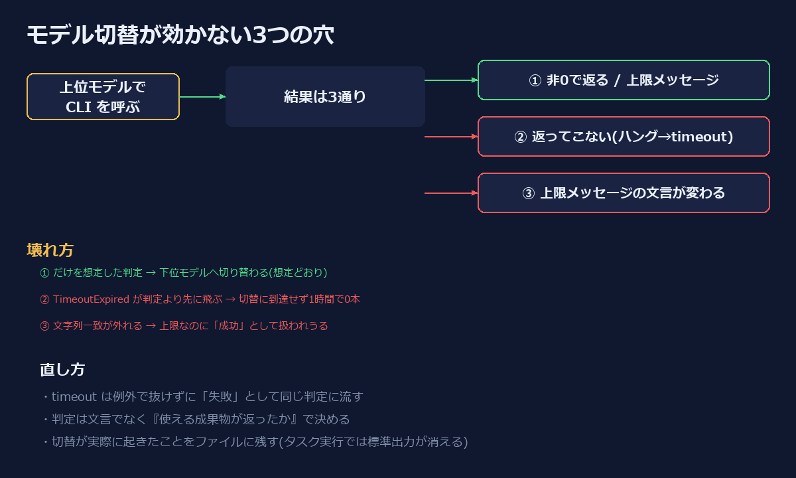

個人の自動化プロジェクトで、記事の下書きや改善の計画づくりを LLM の CLI(`claude --print`)に任せている。上位モデルを指定して呼び、**利用上限に当たったら1段下のモデルでやり直す**、というフォールバックを入れていた。

そのフォールバックが、必要な日に一度も動かなかった。直したあと、2か月後に別のスクリプトで同じ仕組みを書いたら、**同じ穴をもう一度掘っていた**。この記事はその2回分の記録。



## 症状: 切替のコードはあるのに、その日の成果物が0本

1回目は記事の自動生成スクリプト。2つのサイト向けの記事が、その日そろって0本で終わった。タスクの結果コードは失敗。

コードには、上限のときに既定モデルへ切り替える処理がすでにあった。

```python
_LIMIT_RE = re.compile(r"reached your Fable ?5? limit|usage-credits", re.I)

p = _run(model)                      # 上位モデルを指定
combined = (p.stdout or "") + (p.stderr or "")
if model and (p.returncode != 0 or _LIMIT_RE.search(combined)):
    p = _run(None)                   # 既定モデルでやり直す
```

非0で返っても、0で返って上限の文言が混ざっていても切り替わる。ここだけ見ると、ちゃんと書けているように見える。

## 原因1: 上限の CLI は「上限です」と即答せず、ハングする

答えは `_run()` の中にあった。

```python
def _run(m):
    try:
        return subprocess.run(cmd, input=prompt, capture_output=True,
                              text=True, encoding="utf-8", timeout=300)
    except subprocess.TimeoutExpired:
        raise SystemExit(f"claude timeout ({timeout}s)")   # ← ここで即終了
```

その日のログはこうだった。

```
claude timeout (300s)
[10:44] author FAILED rc=1, retry after 60s
[warn] model=... unavailable ("You've reached your Fable limit...
claude timeout (300s)
[11:07] author still failing, abort
```

1回目の呼び出しは、**上限のメッセージすら返さずに 300 秒固まった**。`TimeoutExpired` を `SystemExit` に変えて投げているので、プロセスはその場で終わる。下にある切替の判定には到達しない。外側のリトライで2回目に入り、ようやく上限の文言が出たが、そこでもまたタイムアウトした。1時間かけて0本。

フォールバックは「非0で返ってきたら」を前提に書かれていた。でも上限・混雑・回線の不調は、たいてい **「返ってこない」側** に出る。

### 対処: タイムアウトを例外にせず、同じ判定に流す

```python
def _run(m):
    try:
        return subprocess.run(cmd, ..., timeout=timeout)
    except subprocess.TimeoutExpired:
        print(f"[warn] claude timeout ({timeout}s) model={m or '既定'}", file=sys.stderr)
        return None                                      # 失敗として返す

p = _run(model)
combined = ((p.stdout or "") + (p.stderr or "")) if p else ""
if model and (p is None or p.returncode != 0 or _LIMIT_RE.search(combined)):
    p = _run(None)
if p is None:
    raise SystemExit("既定モデルでも返らなかった")       # 諦めるのは切替のあと
```

ポイントは `p is None` を切替の条件に足したこと。タイムアウトを「エラーの一種」として、非0終了と同じ道に乗せる。修正後、同じ2サイトの記事は約7分で2本とも公開された。

(Windows で `.cmd` 経由の CLI を `subprocess.run(timeout=)` で呼ぶと、そもそもタイムアウトが効かずに戻ってこない問題もある。これは別記事「subprocess.run(timeout=600) が5時間戻らなかった」に書いた。この記事の時点では、子プロセスの木ごと止める版の `run` に置き換え済み。)

## 原因2: 上限メッセージの文言が変わっていた

2か月後、毎日2回動く「改善の計画を作る」スクリプトが、昼も夜も計画を作れずに止まった。こちらは計画役に上位モデルを固定していて、フォールバックは無かった。CLI の出力にはこうあった。

```
You've hit your Fable limit · resets Nov 17, 4am (Asia/Singapore). Switch to another model, ...
```

1回目のときの文言は **`You've reached your Fable limit`** だった。今回は **`hit your ... limit`**。1回目のスクリプトの正規表現 `reached your Fable ?5? limit` は、今の文言には一致しない。

1回目のスクリプトは `returncode != 0` も見ているので、CLI が非0で終わる限りは切り替わる。ただ、わざわざ文言でも判定していたのは「0 で返って本文に上限の文言だけが入る」場合に備えたものだった。その備えは、文言が変わった時点で黙って外れている。エラーメッセージは API の仕様ではないので、予告なく変わる。

## 原因3: 2回目の実装で、タイムアウトの穴をもう一度掘った

計画のスクリプトには、すぐにフォールバックを足した。モデルを fable → opus → sonnet と1段ずつ下げる。

```python
def run_claude(prompt, model, tools, timeout):
    res = run_tree(cmd, input=prompt, capture_output=True, text=True,
                   encoding="utf-8", errors="replace", timeout=timeout)
    out = (res.stdout or "") + (res.stderr or "")
    limited = "hit your" in out and "limit" in out
    if res.returncode != 0 or limited:
        nxt = {"fable": "opus", "opus": "sonnet"}.get(model)
        if nxt:
            log(f"claude({model}) failed (...) → {nxt}")
            return run_claude(prompt, nxt, tools, timeout)
        raise RuntimeError(...)
    return res.stdout
```

翌朝のログには、切替が実際に起きた記録が残った。

```
2026-11-14 08:10:04 claude(fable) failed (limit): You've hit your Fable limit · resets ... → opus
```

ここまでは成功。ただ、この記事を書くためにコードを読み返して気づいた。**`run_tree` は `subprocess.run` と同じく `TimeoutExpired` を投げる**。`run_claude` の中にそれを捕まえる場所は無い。つまり上限のときに CLI が「返ってこない」側に出たら、1回目とまったく同じく、切替に入る前に例外で抜ける。文言の判定も、今度は `hit your` だけを見ていて、以前の `reached your` には一致しない。

1回目の教訓はメモに残していたし、1回目のスクリプトのコメントにも「返ってこないときにもフォールバックが要る」と書いてあった。それでも、新しく書いた関数には入っていなかった。**教訓が書いてある場所と、新しいコードを書く場所が違った**から。

### 対処: 切替の判定を1か所にまとめ、3通りの結果を同じ道に乗せる

以下は、2本のスクリプトがそれぞれ持っている判定を1つの関数にまとめるときの形。この記事の時点では、まだ2本とも置き換えていない。

```python
def call_once(cmd, prompt, timeout):
    """結果を (ok, text, reason) で返す。例外は外に出さない。"""
    try:
        res = run_tree(cmd, input=prompt, capture_output=True, text=True,
                       encoding="utf-8", errors="replace", timeout=timeout)
    except subprocess.TimeoutExpired:
        return False, "", "timeout"
    out = (res.stdout or "") + (res.stderr or "")
    if res.returncode != 0:
        return False, out, f"rc={res.returncode}"
    if not looks_like_valid_output(res.stdout):    # 文言ではなく成果物で判定
        return False, out, "unusable output"
    return True, res.stdout, "ok"

def call_with_fallback(prompt, models, timeout):
    for m in models:
        ok, text, why = call_once(build_cmd(m), prompt, timeout)
        log(f"model={m} ok={ok} reason={why}")
        if ok:
            return text
    raise RuntimeError("全モデルで失敗")
```

やっていることは3つ。

1. **タイムアウトは例外で抜けず、失敗の一種として返す。** 呼び出し側から見て「非0」「ハング」「中身がおかしい」が同じ形になる
2. **上限の判定を文言に頼らない。** 期待する出力(この用途では末尾の JSON)が取れたかで決める。取れなければ理由が何であれ次のモデルへ
3. **切替の事実をファイルに残す。** タスクスケジューラから動かすと標準出力は残らない。2回目の計画スクリプトも、最初は失敗の理由が見えなかった。どのモデルで何が起きたかを1行ずつ追記するようにして、はじめて「本当に切り替わった」と確かめられた

## 教訓

- **フォールバックは「エラーが返ったとき」ではなく「使える結果が返らなかったとき」に掛ける。** 上限・混雑・回線の不調は、エラーより先にハングとして出ることが多い
- **`timeout=` を付けた呼び出しと、その上のフォールバック判定の間に `raise` が無いかを見る。** 例外で抜けた時点で、下の判定は全部飾りになる
- **エラーメッセージの文字列一致は、いつか黙って外れる。** 判定の主軸は終了コードと成果物の形にして、文言は補助にとどめる
- **同じ仕組みを2回書くなら、1回目の関数を使い回す。** 教訓をメモやコメントに書いても、新しいファイルを書く手は別の場所にある。判定をまとめた関数を1つにしておくのが、いちばん確実な「覚えておく」方法だった
- **切替は、起きたことをファイルで確かめるまで「動く」と言わない。** 実装してから実際に上限に当たるまで、フォールバックは一度も通っていないコードのまま置かれている

---

📩 LINE で深掘り配信中

AI / マーケ / 楽天モバの限定情報を 週1〜2回 お届け（無料）

興味のあるテーマだけ選んで受け取れます

[友だち追加する 👉](https://mame-follow.suikou0.workers.dev/follow?cha=zenn)

AIエージェント運用 / MMM / 楽天モバ紹介 の3テーマから選べます
