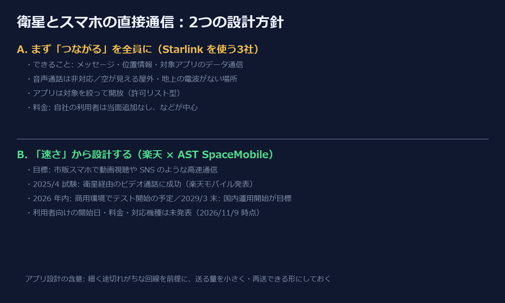

2026年11月9日、楽天グループと米 AST SpaceMobile が、衛星とスマホの直接通信（衛星ダイレクト通信）の新会社「Rakuten AST」を設立すると発表しました。これで日本の携帯4社が、そろってこの分野に取り組むことになります。

ただ、各社の発表を並べてみると、同じ「衛星」でも目指している方向がはっきり違います。この記事では、**各社の公式発表に書かれていることだけ**を材料に、その違いを設計方針として整理します。衛星や電波の内部の仕組みについては、公式に確かめられたことしか書きません。

## 方針A：まず「つながる」を、全員に

au（2025年4月〜）、ソフトバンク（2026年4月10日〜）、ドコモ（2026年4月27日〜）は、いずれも SpaceX の Starlink を使っています。公式の案内から読み取れる設計は、かなり共通しています。

- **機能を絞る**：テキストメッセージ（各社で SMS・RCS・iMessage など）、位置情報の共有、対象アプリのデータ通信が中心。**音声通話は3社とも非対応**
- **条件を絞る**：空が見える屋外で、自社の 4G・5G の電波が届かない場所
- **アプリを許可リストで開放する**：au は Web の閲覧・動画・SNS には対応せず、YAMAP や天気アプリなど一部のアプリを使える形。ソフトバンクは LINE や PayPay などを順に対応（LINE はテキストと位置情報のみ）、ドコモも対象アプリを列挙
- **対象を広く取る**：対応機種は au 107機種（2026年9月時点）、ドコモ 84機種・ソフトバンク 82機種（いずれも発表時）。ドコモは ahamo を含む全プランで当面無料・申込み不要

帯域が細く、条件も限られた回線を、**いきなり汎用のインターネットとして開放しない**判断です。何でも通すと、帯域を食う通信が混ざって、肝心の「連絡が取れる」が保証できなくなります。そこで用途を先に決め、通してよいものだけを通す。プロダクトとしては「最低限の体験を、できるだけ多くの人に、早く」届ける設計です。

## 方針B：「速さ」から設計する

楽天モバイルが組む AST SpaceMobile のほうは、出発点が違います。

- 2025年4月23日の楽天モバイルの発表では、衛星と**市販のスマホ**の直接通信で、福島と東京の間の**ビデオ通話**に成功したとしています。日本国内での提供開始は「2026年第4四半期」を目指し、提供時間や価格は「未定」でした。
- 2026年11月9日の楽天グループの発表では、**動画視聴や SNS のような高速通信**を、特別な機器なしに市販のスマホで使えるようにする、と説明しています。新会社は総務省の低軌道衛星の事業（J-LEO）として、約3年で最大1,480億円の交付を受ける予定です。目標は**2029年3月末までの衛星通信網の構築と国内での運用開始**で、楽天モバイルは**2026年内に商用環境でのテストを始める予定**です。

こちらは「まず細い回線で連絡手段を」ではなく、**地上の回線に近い体験を目標に置く**方針です。そのぶん、インフラの整備に時間をかける計画になっています。利用者向けの開始日・料金・対応機種は、2026年11月9日時点で発表されていません。

## 比べると見えるトレードオフ

| | 方針A（Starlink を使う3社） | 方針B（楽天 × AST） |
|---|---|---|
| 最初に保証するもの | 圏外でも連絡が取れること | 高速通信の体験 |
| 開放の仕方 | 用途とアプリを絞る | 汎用の通信を目指す |
| 時間軸 | すでに提供中 | テストは2026年内、国内運用開始は2029年3月末が目標 |
| 未確定のこと | 料金に「当面」「予定」が付くものがある | 開始日・料金・対応機種 |

どちらが正しいという話ではありません。A は「今日、山で遭難しかけた人に届く」価値を先に取り、B は「将来、圏外という概念そのものを薄める」価値を狙っています。ソフトウェアで言えば、MVP を早く出して用途を広げていくか、目標の体験から逆算して土台を作るか、という違いに近いと思います。

## アプリを作る側への含意

衛星経由の通信を、アプリがどう扱うべきかは、まだ方針Aの世界で考えるのが現実的です。公式の案内から言えるのは次の点です。

- **対象アプリに入らない限り、データ通信はできない**ことがある（許可リスト型）。自分のアプリが使えると思い込まない
- 使える場面は「空が見える屋外で、地上の電波がない場所」。**つながったり切れたりする**ことを前提にする
- 送るデータを小さくし、送れなかったら後で送り直せる作りにしておくと、衛星でも地上の弱い電波でも同じ設計で救える

方針B が実現すれば、こうした前提は変わる可能性があります。ただ、それは発表を待ってから考えれば十分です。今の段階で「衛星があるから大丈夫」と設計を緩めるのは、早すぎると思います。

## 出典

- 楽天グループ「楽天と米AST、日本における衛星ダイレクト通信構築に向けた新会社『Rakuten AST』を設立」（2026年11月9日）https://corp.rakuten.co.jp/news/press/2026/1109_01.html
- 楽天モバイル「楽天モバイルと米AST SpaceMobile、日本国内で初めて低軌道衛星と市販スマートフォンの直接通信試験によるビデオ通話に成功」（2025年4月23日）https://corp.mobile.rakuten.co.jp/news/press/2025/0423_01/
- au「au Starlink Direct」https://www.au.com/mobile/service/starlink-direct/
- NTTドコモ「docomo Starlink Direct」を4月27日から提供開始（2026年4月2日）https://www.docomo.ne.jp/info/news_release/2026/04/02_01.html
- ソフトバンク「SoftBank Starlink Direct」を4月10日に提供開始（2026年4月10日）https://www.softbank.jp/corp/news/press/sbkk/2026/20260410_03/

※筆者は楽天グループの従業員です。この記事は各社の公開情報をもとにした個人の整理で、会社の見解ではありません。

