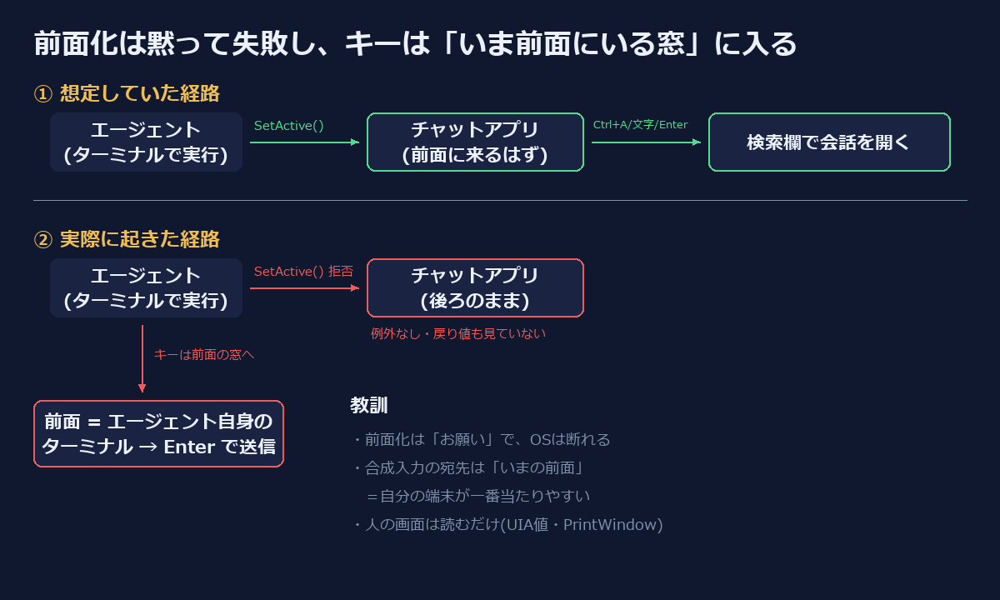

個人の自動化プロジェクトで、AIコーディングエージェント(ターミナルで動く CLI 型)に「デスクトップのチャットアプリから、ある会話の中身を取り出して」と頼んだ。

エージェントは Python の `uiautomation` で、チャットアプリのウィンドウを前面に出し、検索欄に会話名を打って Enter を押す、というスクリプトを書いて実行した。

結果、**チャットアプリには何も起きなかった。** 代わりに、打たれた文字列と Enter は**エージェント自身が動いているターミナル**に入り、そこで「ユーザーの新しい入力」として送信された。

例外は出ていない。スクリプトは正常終了している。


*想定は ① の経路。実際は SetActive が断られ、キーは前面にいたターミナルへ流れた*

## 症状

実行されたのは、だいたいこういうコードだった。

```python
import uiautomation as auto

win = auto.WindowControl(searchDepth=1, ClassName="Qt5QWindowIcon", SubName="Chat")
win.SetActive()                      # ← 前面に出す「つもり」
search = win.EditControl(Name="Search")
search.Click()                       # ← 画面座標へのクリック
auto.SendKeys("{Ctrl}a{Delete}")
auto.SendKeys("会話の名前")
auto.SendKeys("{Enter}")
```

読むと何の問題もなさそうに見える。手元で、チャットアプリを自分で前面にしてから実行すれば実際に動く。

ところがエージェントが実行すると、こうなる。

1. `SetActive()` を呼ぶ → チャットアプリは**後ろのまま**
2. `Click()` → 検索欄の座標をクリックするが、その座標の上には別のウィンドウが乗っている
3. `SendKeys` → キーは「その時点で前面にいるウィンドウ」に届く
4. その前面のウィンドウは、**エージェント自身を表示しているターミナル**
5. Ctrl+A・Delete で入力欄が消され、会話名が打たれ、Enter で送信される

エージェントの側から見ると、ユーザーが急に意味の通らない一文を送ってきたように見える。人間から見ると、自分が打っていない指示が勝手に送られている。今回は無害な文字列だったが、もし打つ内容が「メッセージの本文」だったら、それがそのまま**エージェントへの指示**として解釈されていた。

## 原因1: 前面化は「お願い」で、OS は断れる

Windows には前面化の制限がある。`SetForegroundWindow` は、呼び出し側が「いま前面のプロセス」や「直近の入力を受けたプロセス」などの条件を満たさないと**拒否される**。拒否されたときはタスクバーのボタンが点滅するだけで、ウィンドウは前に出てこない。

`uiautomation` の `SetActive()` もこの仕組みの上に乗っている。拒否されても**例外は飛ばない**。戻り値(成否)はあるが、上のコードは見ていなかった。

エージェントは、ターミナルから起動された子プロセスとしてスクリプトを走らせる。ユーザーはその間キーボードに触っていない。つまり**「前面化を断られやすい条件」がそろった状態で毎回呼んでいる**ことになる。手で試すと動くのに、エージェント経由だと動かないのはこのためだ。

## 原因2: 合成入力には宛先が無い

`SendKeys`(内部的には `SendInput`)は、**特定のウィンドウ宛てにキーを送る API ではない**。キーボードを打ったのと同じイベントを OS の入力キューに流すだけで、受け取るのは「その瞬間に前面でフォーカスを持っているウィンドウ」だ。

`Click()` も同じで、要素の「画面上の座標」をクリックする。要素が別のウィンドウの下に隠れていれば、上に乗っているウィンドウがクリックされる。

ここで嫌なのは、**前面化に失敗したときに前面にいる確率が一番高いのが、エージェント自身のターミナル**だという点だ。ユーザーはエージェントとやりとりしていたのだから、当然そこが前面にある。失敗したときの「流れ先」が、よりによって指示を受け付ける窓になっている。

## 対処1(最低限): 送る前に前面を確かめる

キー入力をどうしても送るなら、送る直前に前面のウィンドウを確かめ、違えば止める。

```python
import ctypes
import uiautomation as auto

user32 = ctypes.windll.user32

def send_keys_only_if_foreground(win: auto.WindowControl, keys: str) -> None:
    win.SetActive()
    fg = user32.GetForegroundWindow()
    if fg != win.NativeWindowHandle:
        raise RuntimeError("target is not foreground; refusing to send keys")
    auto.SendKeys(keys)
```

ただしこれは「確認した瞬間」の話で、確認と送信の間に前面が入れ替わる可能性は残る。複数回に分けて送るなら毎回確かめる必要がある。**根本的には安全にならない**ので、今回はこれを採らなかった。

## 対処2(採用): 人の画面には書き込まない。読むだけにする

方針を「エージェントはユーザーのデスクトップアプリにキー入力・クリックを送らない」に変えた。

- **会話を開く操作はユーザーが手でやる。** エージェントは「この会話を開いてください」と頼んで待つ
- **本文の読み取りは UI Automation の値取得で。** フォーカスも入力も要らない

```python
def read_bubbles(win: auto.WindowControl) -> list[str]:
    texts = []
    for c, _depth in auto.WalkControl(win, maxDepth=30):
        if c.ControlTypeName == "EditControl":
            try:
                v = c.GetValuePattern().Value
            except Exception:
                continue
            if v:
                texts.append(v)
    return texts
```

- **UI Automation で取れない情報(送信者名など)は画面を撮って読む。** `PrintWindow` はウィンドウが他の窓の後ろに隠れていても描画内容を取れる(最小化されていると撮れない)

```python
import ctypes
from ctypes import wintypes
import win32gui, win32ui
from PIL import Image

PW_RENDERFULLCONTENT = 2

def capture_hidden(hwnd: int) -> Image.Image:
    l, t, r, b = win32gui.GetWindowRect(hwnd)
    w, h = r - l, b - t
    hdc = win32gui.GetWindowDC(hwnd)
    src = win32ui.CreateDCFromHandle(hdc)
    mem = src.CreateCompatibleDC()
    bmp = win32ui.CreateBitmap()
    bmp.CreateCompatibleBitmap(src, w, h)
    mem.SelectObject(bmp)
    ctypes.windll.user32.PrintWindow(hwnd, mem.GetSafeHdc(), PW_RENDERFULLCONTENT)
    info = bmp.GetInfo()
    img = Image.frombuffer("RGB", (info["bmWidth"], info["bmHeight"]),
                           bmp.GetBitmapBits(True), "raw", "BGRX", 0, 1)
    win32gui.DeleteObject(bmp.GetHandle()); mem.DeleteDC(); src.DeleteDC()
    win32gui.ReleaseDC(hwnd, hdc)
    return img
```

- **スクロールはスクロールバーの値で動かす。** ホイールやキーではなく、UI Automation の RangeValue パターンに値を書く。これはそのウィンドウの要素に対する操作なので、前面がどこであっても他の窓には飛ばない

```python
sb = win.ScrollBarControl(searchDepth=20)
rv = sb.GetRangeValuePattern()
rv.SetValue(max(rv.Minimum, rv.Value - rv.LargeChange))   # 1画面ぶん上へ
```

一点だけ注意がある。アプリによっては**前面にいないと UI Automation の木がほとんど空になる**ことがある。その場合も、エージェントが前面化を試みるのではなく、ユーザーに前に出してもらう。

## 教訓

- **前面化 API は「お願い」で、OS は黙って断れる。** 例外が出ないので、戻り値か `GetForegroundWindow` で確かめない限り失敗に気づかない
- **合成キー入力・座標クリックには宛先が無い。** 届く先は「その瞬間の前面」で、指定した要素ではない
- **エージェントが自分で入力を合成すると、失敗時の流れ先は高い確率でエージェント自身のターミナルになる。** 誤送信先が「指示の入口」なので、普通の誤操作より危ない
- 人間が使っているデスクトップに対しては、**読む操作(要素の値・隠れたまま撮る・要素のプロパティ操作)と、書く操作(キー・クリック)を分ける**。エージェントには前者だけを許し、後者はユーザーの手に残す

「手で試したら動いた」は、自分が前面を握っている状態での確認でしかない。エージェントが実行するときは、前面を握っているのはエージェントではなく、たいていエージェント自身の画面だ。

---

📩 LINE で深掘り配信中

AI / マーケ / 楽天モバの限定情報を 週1〜2回 お届け（無料）

興味のあるテーマだけ選んで受け取れます

[友だち追加する 👉](https://mame-follow.suikou0.workers.dev/follow?cha=zenn)

AIエージェント運用 / MMM / 楽天モバ紹介 の3テーマから選べます
